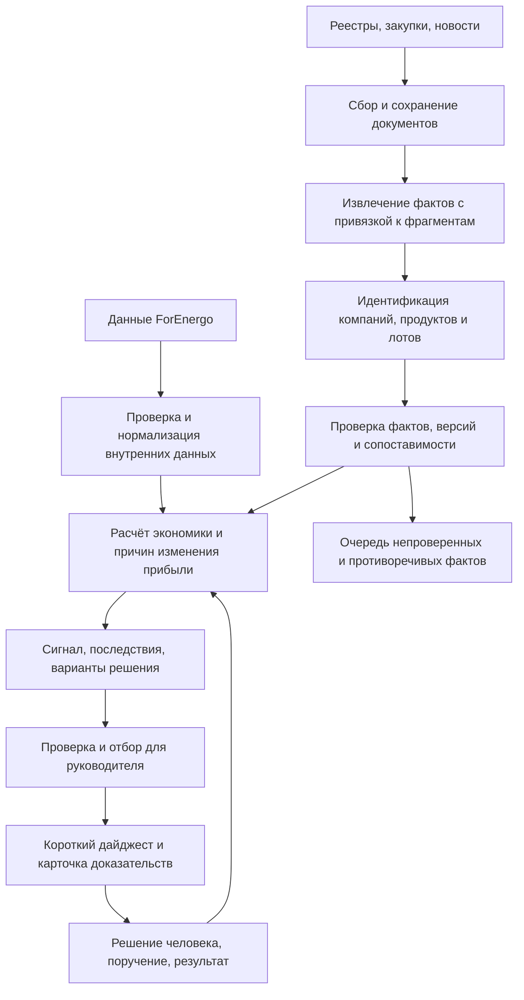

# ForEnergo: решения для защиты прибыли

Предложение для согласования к встрече 20 сентября 2026 года. Подготовлено 16 сентября. Это проект продукта и архитектуры; разработка и подключение источников по этому документу не выполнялись.

Дополнение после чтения переписки с Николаем Алексеевичем: [как объединить его шесть треков](/home/roomhacker/airlock-admin/FORENERGO_SIX_TRACKS_2026-09-16.md). Тендеры, конкуренты и рекомендации связываются с контролем исполнения; к короткому дайджесту добавляется управленческая записка на 2–3 страницы с контрольными параметрами бюджетов.

**Предлагаю строить систему, которая помогает ForEnergo сохранять прибыль при конкуренции за тендеры.** Анализ конкурентов обеспечивает её фактами. Главный результат для президента — короткий дайджест: где теряем деньги, что изменилось на рынке и какое решение требуется.

Уточнение задачи: выручка растёт, прибыль падает. Причина пока не установлена. Давление конкурентов — проверяемая гипотеза наряду с изменением себестоимости, структуры продаж, накладных расходов и стоимости финансирования.

## 1. Что я хотел бы получать как руководитель

Каждое утро — до 3–5 существенных пунктов, которые можно прочитать за минуту. Если значимых изменений нет, не заполнять дайджест случайными новостями. Срочное уведомление отдельно — только когда решение нельзя отложить до следующего выпуска.

Каждый пункт отвечает на пять вопросов: **что произошло → где затрагивает нас → каковы последствия → что предлагается сделать и кому → чем подтверждено**. Неизвестный эффект обозначается неизвестным; срочность определяется сроком решения.

Пример формата ниже полностью условный. Названия лотов, числа и ситуации не являются результатами анализа ForEnergo.

> **Сегодня — три решения**
>
> 1. **Скидка по лоту А.** Дополнительная уступка снижает расчётную маржу с 13% до 8% при согласованном пороге 10%. Коммерческому директору: до 18:00 проверить изменение условий оплаты вместо дальнейшей скидки. Основание: калькуляция и условия закупки.
>
> 2. **Конкурент Б усилился у заказчика В.** Его победы подтверждены в пяти из семи наблюдаемых сопоставимых лотов. Руководителю продаж: разобрать два проигрыша — цену, допуск и сроки. Основание: протоколы; причина проигрышей пока не установлена.
>
> 3. **Изменилась структура продаж.** Доля группы с низкой маржой выросла. Финансовому директору: проверить её вклад в снижение прибыли перед утверждением плана продаж. Основание: управленческий отчёт; расчёт требует сверки.

Под каждым пунктом доступны «Доказательства», «Поручить», «Нужна проверка», «Неактуально». Поручение возникает после решения человека. В конце недели — короткий отчёт: какие решения приняли, что выполнено и какой эффект удалось подтвердить.

В самом сообщении президент видит вывод. По ссылке — одностраничное обоснование: факты, расчёт, ограничения, альтернативы и исходные документы.

## 2. Два связанных контура продукта

| Контур | Вопрос руководителя | Результат |
|---|---|---|
| Прибыль | Почему при росте выручки прибыль снизилась? | Разложение изменения прибыли по причинам и направлениям |
| Тендеры | Где и на каких условиях стоит конкурировать дальше? | Рекомендация по конкретному лоту с расчётом и доказательствами |

Вначале согласовываем с финансовым директором, какая именно прибыль падает: валовая, операционная или чистая; по какому периоду и периметру группы. Сравниваем одинаковые периоды и учитываем сезонность. Исключаем двойной учёт внутригрупповых продаж.

Для первого контура строим объяснение изменения прибыли: объём → цена → ассортимент и заказчики → себестоимость → расходы → финансирование → разовые статьи. Метод распределения эффектов должен быть понятен финансовой службе, сходиться с отчётом и отдельно показывать необъяснённый остаток.

Для второго контура соединяем историю сопоставимых закупок с нашей экономикой. Получаем варианты: участвовать на текущих условиях; изменить условия; запросить уточнение; вынести исключение на согласование; отказаться. Если данных недостаточно, правильный результат — конкретный следующий шаг по проверке.

**Рост доли побед не является самостоятельной целью:** можно выигрывать больше и зарабатывать меньше. Оцениваем вклад заказов в прибыль и потребность в оборотных средствах.

## 3. Три внешних потока и один необходимый внутренний

| Поток | Что собираем | Для чего используем | Ограничение |
|---|---|---|---|
| Официальные сведения | Идентификаторы, изменения юрлиц, опубликованная отчётность; существенные судебные и иные события по мере необходимости | Правильная идентификация, структура групп, финансовый фон и риски | Годовые показатели не описывают текущую экономику отдельного заказа |
| Закупки | Извещения, изменения, спецификации, раскрытые заявки, допуск, протоколы, договоры и опубликованные сведения об исполнении | Кто с кем конкурирует, при каких условиях и с каким наблюдаемым результатом | Доступность участников, цен и итогов проверяется отдельно для каждой процедуры |
| Новости и раскрытия компаний | Производственные мощности, новые продукты, аттестации, крупные проекты, изменения каналов продаж | Ранние признаки изменения конкуренции в конкретном сегменте | Заявление компании и независимо подтверждённое событие имеют разный статус |
| Данные ForEnergo | Наши заявки, продажи, затраты, условия оплаты, результат торгов и исполнения | Связь действий конкурентов с нашей прибылью | Требуются согласованные определения и доступ к собственным данным |

Официальные данные нельзя считать одинаково медленными: регистрационные события и годовая отчётность имеют разную природу. Например, проверенный набор ФНС обновлён 25.08.2026, но содержит доходы и расходы за 2025 год. В продукте должны быть видны обе даты. [Паспорт набора ФНС](https://www.nalog.gov.ru/opendata/7707329152-revexp/), [описание ГИР БО](https://www.nalog.gov.ru/rn77/bo/).

Начальные маршруты исследования: [ЕГРЮЛ/ЕГРИП](https://egrul.nalog.ru/), [сервисы открытой информации ФНС](https://www.nalog.gov.ru/donline/), [ЕИС](https://zakupki.gov.ru/), площадка и сайт заказчика, первичные документы компаний. Наличие сайта или записи в каталоге источников ещё не подтверждает работоспособность автоматического сбора.

Не обещаем видеть все закупки и все продажи рынка. Показываем наблюдаемый периметр: площадки, заказчики, периоды и типы документов. «Не нашли» и «не было» — разные результаты.

Платный агрегатор рассматриваем после проверки на выбранной выборке: что он добавляет к покрытию, насколько быстро обновляется, отдаёт ли документы и исходные идентификаторы, разрешает ли нужное использование данных. Цены и доступность API требуют отдельной проверки перед покупкой.

## 4. Единица анализа — лот, продукт и участник

ForEnergo работает с несколькими семействами продукции: изоляторами, линейной арматурой, ОПН, устройствами защиты и другими изделиями. Их нельзя объединять в один ценовой ряд. Номенклатура подтверждается [официальным сайтом](https://forenergo.ru/) и [каталогами](https://forenergo.ru/katalogi).

Система связывает: **группа компаний → юрлицо → роль в сделке → заказчик → закупка → лот → товарная позиция → предложение → результат**.

ИНН/ОГРН служат опорой для российских юрлиц. Названия, бренды и прежние наименования — дополнительные признаки. Связи группы имеют источник и период действия. Победа дилера сама по себе не доказывает победу определённого производителя.

Прямых конкурентов выявляем по совместному участию в сопоставимых закупках. Совпадение ассортимента даёт кандидата для наблюдения, но ещё не доказывает реальное соперничество.

Перед любым сравнением цены проверяем:

1. Совпадение товара, технических требований, класса напряжения и обязательных допусков.
2. Количество, единицу измерения, комплектность; цену единицы и цену всего лота не смешиваем.
3. Валюту, НДС, доставку, гарантии, сроки и условия оплаты.
4. Стадию процедуры: начальная цена, раскрытая заявка, итоговое предложение, договор.
5. Технический статус участника, достоверность результата и изменения документов.
6. Период сравнения и изменения затрат; смешанный лот без расшифровки может оказаться несопоставимым.

Результат проверки — «сопоставимо», «сопоставимо с явно указанными поправками» или «сравнивать нельзя». Поправки имеют формулу и источник. Неизвестные параметры не заполняются догадкой.

По конкуренту показываем наблюдаемые участия и победы с размером выборки, ценовые отклонения, клиентов, продуктовые сегменты, отклонения по допуску и изменения поведения. Долю побед считаем только среди процедур с известными участием и исходом; общую долю рынка из этого не выводим.

Не переносим минимальную цену старой закупки в новую автоматически. В первой версии предпочтительны конкретные аналоги и их разброс. Прогноз диапазона цены или вероятности победы появляется только после проверки на последующих по времени закупках, без использования будущих результатов при обучении.

## 5. Как рассчитывается экономическое решение

Минимальный внутренний набор для пилота — выгрузка за 6–12 месяцев по выбранным продуктовым группам: наши предложения и исходы, фактические продажи, затраты и условия оплаты. Начать можно с согласованных таблиц, без немедленной интеграции с учётной системой.

Для выбранного нового лота нужны: количество, наша цена, актуальная калькуляция, логистика, обеспечение и гарантии, сроки производства, оплата и потребность в финансировании. Для каждой величины фиксируются дата, источник и ответственный.

Сначала считаем ожидаемый вклад заказа по согласованной модели. Отдельно показываем, что включено в затраты и что остаётся на покрытие постоянных расходов. Этот показатель не называем чистой прибылью компании.

Для простой модели, где все учитываемые затраты известны фиксированной суммой, нижняя цена при целевой марже к выручке равна `затраты / (1 − целевая маржа)`. Если затраты зависят от цены или сроков, пересчитываем сценарий. Все величины приводим к одной валютной и налоговой базе.

Рекомендация включает текущий вариант, один-два возможных изменения условий и последствия для маржи и денег. Например: сохранить цену; обсудить аванс; изменить партию или график в допустимых условиях процедуры; отказаться от дополнительной скидки.

Уровень маржи и исключения утверждает ForEnergo. Для загрузки свободных мощностей и для обычной продажи могут действовать разные согласованные правила. Система показывает последствия, а коммерческое решение остаётся у уполномоченного руководителя.

Если себестоимости нет, система может показать конкурентный факт и перечень недостающих данных. Рекомендовать «снижайте цену до X» в таком состоянии нельзя. Из прибыли конкурента за прошлый год его минимальную допустимую цену также не вычисляем.

## 6. Доказательства: проверяется каждое существенное утверждение

Ссылка на сайт — начало проверки. Для каждого факта сохраняем конкретный документ и место в нём: страницу, пункт, строку таблицы или фрагмент текста.

Карточка доказательства содержит первичный URL и идентификатор, оригинал или допустимую сохранённую копию, контрольную сумму, издателя, дату события, публикации и получения, период действия, версию документа и способ извлечения. Копия и хеш помогают воспроизвести проверку, но сами по себе не доказывают истинность содержания.

Утверждения хранятся отдельно от документов. Для утверждения указываются субъект, значение, единицы, период, подтверждающие и противоречащие материалы. «Компания объявила запуск линии» и «линия производит заявленный объём» — два разных утверждения.

Порядок проверки:

1. Установить юрлицо, закупку и предмет документа.
2. Проверить, действительно ли фрагмент подтверждает заявленный факт.
3. Сверить числа, единицы, даты, стадию и статус; проверить наличие более новой версии.
4. Найти противоречия и происхождение повторных публикаций. Десять перепечаток одного релиза считаются одной исходной публикацией.
5. Отделить подтверждённый факт от расчёта, интерпретации и гипотезы.

Статусы для пользователя: «подтверждено документом», «заявлено компанией», «расчёт на указанных данных», «гипотеза», «противоречие / нужна проверка». Одного надлежащего первичного документа может быть достаточно; двух произвольных ссылок — недостаточно.

Существенные ценовые решения в пилоте проверяет аналитик. Позже автоматическое прохождение разрешается только для проверенных типов документов и правил. Процент уверенности модели не заменяет проверку документа.

Новая версия или исправление факта запускает пересчёт связанных выводов. Предыдущая версия остаётся в истории. Если ошибка уже попала в дайджест, выпускается явное исправление.

## 7. Архитектура системы

Предлагаю сохранить Airlock как оболочку приложения и существующий PostgreSQL. Внутри выделить понятные модули: сбор, документы, факты, сущности, тендеры, экономика, решения и доставка. Начать с одного приложения и фоновых заданий, без отдельного сервиса на каждый этап.

Ключевые сущности хранения: источник; запуск сбора; документ и версия; утверждение и его доказательства; компания и связь группы; продукт; закупка/лот/позиция; предложение и исход; внутренняя калькуляция; сигнал; рекомендация; выпуск дайджеста; поручение и результат.

Оригиналы документов помещаются в закрытое файловое или объектное хранилище, метаданные и связи — в PostgreSQL. Текущую модель хранения можно развивать по мере объёма. Версии фактов и расчётов позволяют восстановить, какие данные были известны в момент рекомендации.

Модель ИИ извлекает структурированные сведения из сложных документов, помогает классифицировать их и формулирует текст. Деньги, проценты, фильтры сопоставимости и правила допуска рассчитываются проверяемым кодом. Каждый существенный тезис текста должен ссылаться на разрешённый набор фактов. Текст источника обрабатывается как данные, а не инструкция системе.

Сбор работает двумя режимами: загрузка истории и последующее получение изменений. У каждого источника свои ограничения, расписание и контрольная точка. Предварительные интервалы для пилота: важные закупки — 30–60 минут, новости — несколько часов, регистрационные изменения — ежедневно, отчётность — по появлению публикаций. Это цели настройки, а не уже подтверждённая скорость получения данных.

Обязательны защита от повторного учёта документов и лотов, повторные попытки после сбоев, очередь ошибок, контроль пропусков и отдельные времена последней успешной загрузки и последнего изменения данных. Работающий сборщик не гарантирует свежесть сведений у источника.

Доставка использует сохраняемую очередь: один сигнал не рассылается заново после перезапуска. Повтор допускается при существенном изменении, сроке решения или исправлении. Состояние доставки отделено от факта прочтения и принятия решения.

Доступы разделяются для президента, финансовой службы, коммерческого блока и аналитика. Себестоимость и рекомендуемые пределы цены доступны только разрешённым ролям и получателям; это ограничение распространяется на дайджесты и поиск ИИ. Историю редактирования и решений сохраняем. Резервное копирование проверяем восстановлением.

## 8. Как выбирать сообщения для президента

Сначала действует проверка качества: хватает ли данных для заявленного вывода. Затем приоритет задают размер возможного эффекта, срок решения, связь с важным заказчиком/продуктом и новизна. При слабых данных формулировка меняется на задачу проверки.

Первые сценарии:

| Сигнал | Основание | Возможное решение |
|---|---|---|
| Скидка выводит заявку ниже согласованной маржи | Собственная калькуляция и условия лота | Проверить альтернативные условия или согласовать исключение |
| В сопоставимом сегменте снизились наблюдаемые цены | Нормализованные позиции и первичные протоколы за сравнимые периоды | Проверить экономику и причины изменения до пересмотра цены |
| Конкурент выигрывает у важного заказчика | Подтверждённые итоги и достаточный контекст участия | Разобрать причины проигрышей: цена, допуск, сроки, требования |
| Растёт выручка низкомаржинального направления | Собственные продажи и сверенный расчёт вклада | Пересмотреть приоритеты продаж и продуктовый состав |
| Появился новый допуск или производственная возможность конкурента | Конкретное раскрытие и дополнительная проверка, где нужна | Оценить затрагиваемые будущие закупки |

Одна история объединяется в один пункт. Исторические данные явно помечаются. Слабый сигнал может остаться у аналитика и не попадать президенту. При недоступности значимого источника нельзя формулировать «на рынке ничего не произошло».

## 9. Что сохранить и изменить в текущем приложении

Прямой запрос страницы `/sources` получил HTTP 401; браузер показал вход Airlock. Поэтому содержимое защищённой страницы и актуальное наполнение базы не проверены. Ниже — выводы по найденному текущему исходному коду, без подтверждения соответствия опубликованной сборке.

Уже есть полезные элементы: компании и досье конкурентов, тендерные доказательства, финансовые сведения, классификация фактов по трём потокам, HTML/RSS-наблюдения, сохранение документов с хешем и фоновые задания. Их следует сохранить.

В прочитанном сборщике HTML сохраняется как документ; структурированные факты автоматически создаются из RSS/Atom. Это хорошая граница: изменение страницы ещё не доказывает бизнес-событие. Полноценные специализированные адаптеры закупок и реестров требуют отдельной реализации и проверки. Объявленные слоты доступа к платным поставщикам сами по себе не являются интеграцией.

В прочитанной функции `tenderDecision` есть полезное предупреждение против автоматического снижения цены. При этом расчёт строится вокруг минимальной наблюдаемой заявки, а сопоставление продукта, НДС, стадии и допуска сформулировано как рекомендация пользователю. В новой системе эти условия должны проверяться **до** расчёта и при необходимости блокировать его.

Также нужно заменить назначаемый источнику процент уверенности проверкой конкретного утверждения. Источник может быть авторитетным, но его документ — относиться к другой стадии процедуры.

Главной страницей предлагаю сделать «Решения для руководителя». Остальные разделы: «Тендеры и экономика», «Почему меняется прибыль», «Конкуренты», «Доказательства». `/sources` остаётся рабочим экраном аналитика и контроля покрытия.

Опорные места проверки кода: [маршруты и регистрация сборщика](</home/roomhacker/airlock-admin/airlock/${HOME}/.local/share/airlock/agents/a81c5a7b-f65d-434c-9761-f1b055b251cf/main.go:20>), [сбор и сохранение](</home/roomhacker/airlock-admin/airlock/${HOME}/.local/share/airlock/agents/a81c5a7b-f65d-434c-9761-f1b055b251cf/internal/intelligence/collector.go:240>), [текущая логика тендерного вывода](</home/roomhacker/airlock-admin/airlock/${HOME}/.local/share/airlock/agents/a81c5a7b-f65d-434c-9761-f1b055b251cf/handlers/home.go:2003>), [модель документов и сбора](</home/roomhacker/airlock-admin/airlock/${HOME}/.local/share/airlock/agents/a81c5a7b-f65d-434c-9761-f1b055b251cf/db/migrations/00007_open_source_collection.sql>). `${HOME}` в этих ссылках — буквальная часть существующего пути.

## 10. Что показывать на встрече 20-го и как запускать пилот

До встречи, после согласования концепции, предлагаю подготовить демонстрацию одного законченного решения: первичный документ → проверенный факт → сопоставление лота → влияние на экономику → короткий вывод. Отдельно показать случай, где данных недостаточно и система объясняет, что нужно проверить.

Для встречи достаточно небольшого проверенного набора исторических закупок и трёх содержательных карточек. Для экономического примера нужны собственные данные хотя бы по одному заказу. Если их нет, демонстрационный расчёт явно обозначается условным; сведения о реальных конкурентах не смешиваются с выдуманными числами. Это объём подготовки после согласования, а не обещание уже готового результата.

Объём первого пилота: 1–2 продуктовые группы, один выбранный контур заказчиков, ориентировочно 6–10 подтверждённых конкурентов и 30–50 разобранных лотов. Фактическое число зависит от доступности сопоставимых документов. Такая выборка служит проверке сбора и правил; она не гарантирует пригодности статистической модели.

Последовательность разработки после согласования:

1. Согласовать определения прибыли и маржи; разобрать небольшой внутренний набор и построить эталонные карточки вручную.
2. Довести путь одного тендера до доказуемого решения: документы, идентификация, сопоставимость, калькуляция и проверка аналитиком.
3. Подключить регулярный сбор нужных источников, короткий дайджест и учёт решений.
4. Добавить разбор динамики прибыли, расширять покрытие и только затем оценивать необходимость прогнозных моделей.

Приёмка проходит через реальные пользовательские сценарии. На размеченной специалистом выборке проверяем компании, стадии, цены и ссылки; отдельно используем ловушки с разным НДС, отклонённой заявкой, старой новостью, неизвестным победителем и неполной калькуляцией. Существенные утверждения должны быть полностью прослеживаемы, а неверный победитель или юрлицо — блокировать приёмку.

Нужны также проверка обнаружения новой версии документа и доставки исправления, сверка расчётов с финансовой службой и контролируемая доставка согласованного дайджеста на выбранный пользователем канал. Оценку интересных пропущенных событий проводим относительно заранее выбранных источников, а не неизвестного «всего рынка».

В пилоте измеряем полезность пунктов для руководителя, долю фактических ошибок и повторов, время от публикации до обнаружения, покрытие выбранных процедур, скорость подготовки решения. Финансовый эффект оцениваем по закрытым заказам: прогноз и факт отдельно. Рост прибыли нельзя заранее приписать продукту без сравнения состава заказов и условий.

## 11. Что предлагаю согласовать сейчас

**Продукт:** помощник президента по защите прибыли, с анализом тендерной конкуренции как первым прикладным сценарием.

**Главный результат:** дайджест из 3–5 решений с доказательствами и ответственными; подробная аналитика открывается по ссылке.

**Граница достоверности:** внешние источники показывают наблюдаемые действия конкурентов, собственные данные позволяют оценить последствия для ForEnergo. При недостатке данных выдаётся задача проверки.

**Первый объём:** один узкий контур продукции и заказчиков, проверяемый путь от документа до решения и постепенное развитие существующего приложения Airlock.

Первый содержательный вопрос на встрече: «Покажите несколько заказов, где выручка выросла, а заработать удалось меньше ожидаемого». Их разбор позволит выбрать пилот по реальной проблеме и установить критерий полезности продукта.
